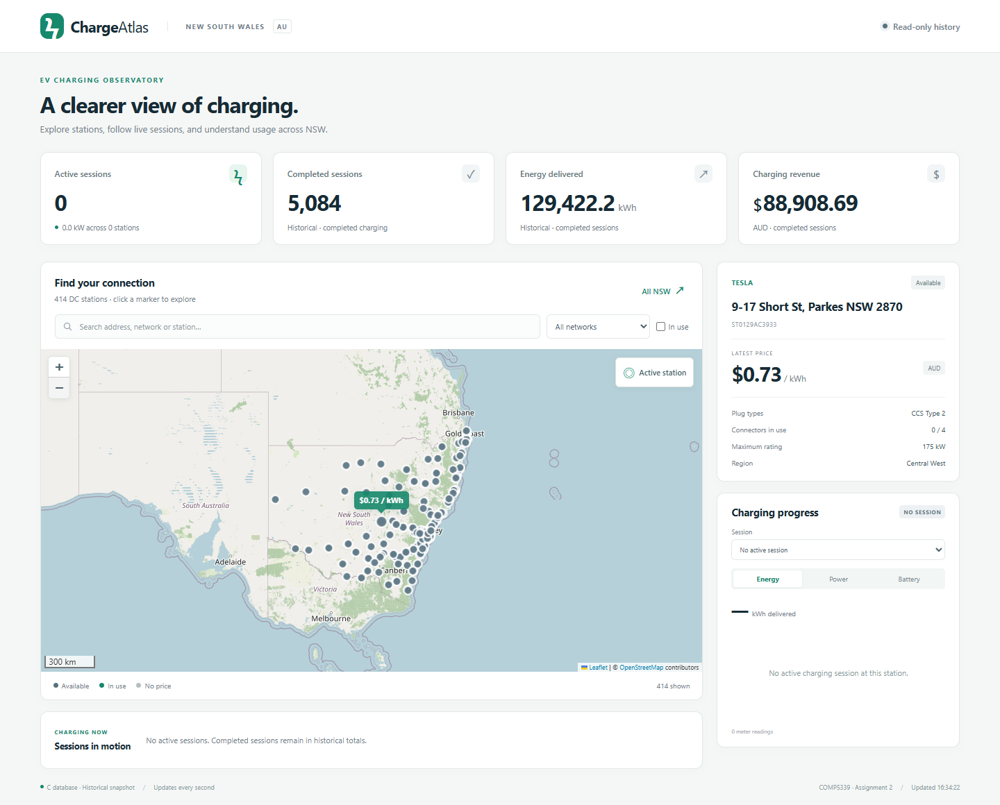
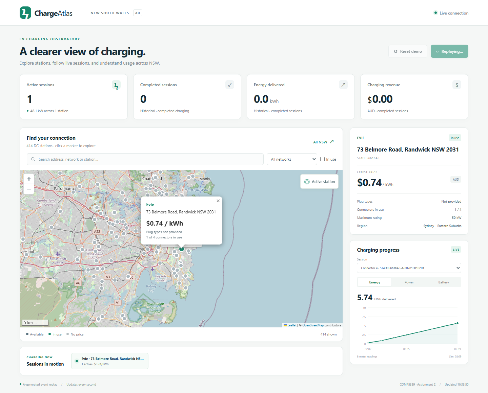

# Dashboard and Visualisation

Verified on 31 October 2026 using the local D implementation and the integrated A/B/C
sources and one-day assessment data delivered with this project.

## Data source and validation design

All reported charging metrics and figures use Member A's output from the supplied
generator. The assessment configuration covers 414 eligible DC stations and 1,610
connectors, with session starts over one day beginning 1 October 2026, seed 5339,
AEMO NSW1-based prices and one-minute meter readings. Later session-end events are
retained; the complete stream therefore ends on 2 October at 01:23:55. Prices,
sessions and metering are generated simulations, not observed EV transactions.

We verified two distinct scopes. First, A's complete 172,803-event stream was
reconciled against C's populated database, which D opened read-only for historical
display. Second, A's existing 36-event demonstration was replayed through real MQTT,
B's subscriber, C's repository and D's browser interface into a separate database
with empty event tables. Each demonstration event was checked for exact equality
with the complete generated stream, retaining its original event ID, sequence,
timestamp and payload. These populations are reported separately below.

## Results

| Measure | Complete stored dataset | A-generated MQTT demonstration |
|---|---:|---:|
| Events | 172,803 | 36 |
| Price updates | 7,038 | 2 |
| Meter readings | 155,597 | 32 |
| Completed sessions | 5,084 | 1 |
| Completed-session energy | 129,422.20 kWh | 22.60 kWh |
| Completed-session revenue | AUD 88,908.69 | AUD 16.72 |
| Active sessions at the end | 0 | 0 |

The full stored dataset has a mean charging duration of 30.61 minutes and a maximum
peak of 183.4 kW. These full-dataset totals are not results of the short MQTT replay
and must not be combined with its totals. Full-stream reconciliation passed with
zero duplicate event IDs/sequences, unknown stations, orphan meters or the checked
price/session/meter mismatches.



Figure D1. D displays the complete stored dataset read-only. All generated sessions
have ended, so zero active sessions is the expected final state.

## Dashboard implementation and live behaviour

Charge Atlas uses Flask and Leaflet. A single runtime owns B's subscriber and
StateStore together with C's EventRepository. Station details are joined to live
state by the original A1 `station_id`; the presentation layer contains neither SQL
nor MQTT parsing. One-second polling updates existing markers, occupancy, price
tooltips and detail popups while preserving the user's map view and filters.
Missing source names use the address, and missing plug types remain `Not provided`.

The live demonstration is A's generated MG4 session at Evie's 73 Belmore Road,
Randwick (`ST4D056616A3`, connector 4). A's publisher delivered all 36 events with
QoS 1 and one-second message spacing; the observed minimum send gap was
1.000 seconds. Playback is accelerated in wall-clock time;
the original simulated timestamps and the 32-minute charging duration are retained.
The station price changes from AUD 0.75 to 0.74/kWh before the session starts.

During charging, the active count becomes one and energy, power and battery SoC
curves grow from actual generated meter samples. The historical cards remain zero
until the session ends because they count completed sessions only. At the end,
the active count returns to zero, completed sessions become one, and historical
energy/revenue become 22.60 kWh and AUD 16.72. The final meter reports 22.599 kWh;
the generator's session summary rounds this to 22.60 kWh. C's historical query keeps
the selected completed curve visible after B removes it from active memory.



Figure D2. The selected generated session is active and its curve is updating.
Historical energy and revenue remain zero until completion, so the curve and
historical cards intentionally represent different states.

## Validation and limitations

The latest full A/B/C/D regression passed all 57 tests. Additional browser
acceptance verified the unmodified A-generated replay, live state/curve updates,
the 32-point completed curve, correct final statistics, reset to an empty event
store and the full-dataset read-only view, with zero JavaScript page errors.
SHA-256 comparisons confirmed that A1, the populated A2 database and the empty
replay seed did not change. Replay and reset write only to a private runtime copy.

The complete stored stream was imported and reconciled offline. We did not perform
the complete 172,803-event paced MQTT replay, which would require at least 4.8 hours
before overhead; the 36-event replay establishes representative transport/UI
behaviour, not full-scale throughput or durable broker-outage recovery. Plug types
are absent for 248 mapped stations in the upstream data; the demonstration station
is one of them. External base-map tiles also require internet access.

## Reproduction

Run the command below, then click **Run demo**:

```powershell
python A2/src/dashboard/run.py --project-root . --mode demo --initial-station ST4D056616A3 --port 8051 --open-browser
```

This opens port 8051, preselects the generated Randwick station, uses the empty
reference seed `A2/data/demo/a_generated_empty.duckdb` and publishes A's
unchanged `A2/data/demo/event_stream.jsonl`. **Reset demo** restores an empty event history.
The earlier hand-crafted UI fixture is not used for this report's results or figures.

## Contribution statement draft

Member D integrated Flask/Leaflet with B's state and C's repository, implemented
map details, live curves, metrics and safe replay/reset, validated A-generated
events through the browser, and prepared the report and screenshots with
acknowledged AI assistance. The student should confirm this statement against
actual participation before combining the group's contributions.
